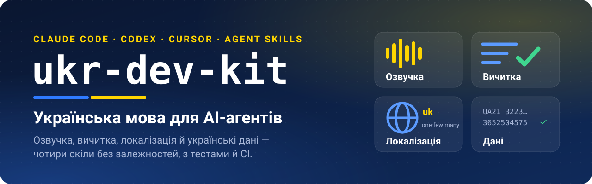
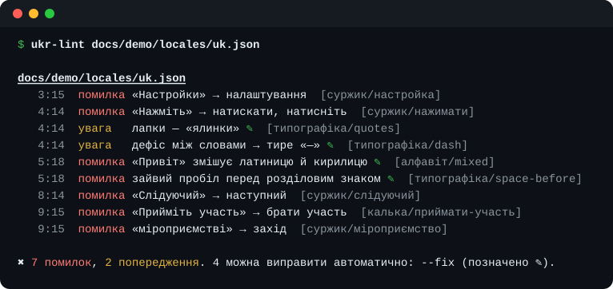
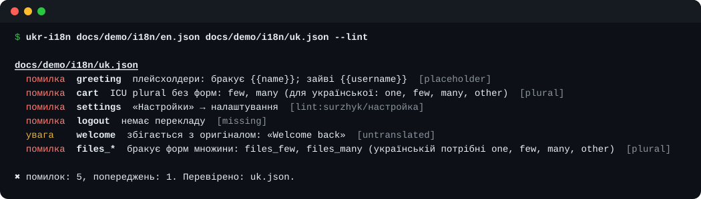

<p align="center">
  
</p>

<p align="center">
  <a href="https://github.com/MaxKarasha/ukr-dev-kit/actions/workflows/ci.yml"></a>
  <a href="https://pypi.org/project/ukr-dev-kit/"></a>
  <a href="LICENSE"></a>
  
  
  
  
  
</p>

<p align="center">
  <b>Чотири скіли, з якими Claude Code, Codex, Cursor та інші агенти працюють з українською як носії:<br>
  озвучують, вичитують, локалізують і перевіряють українські дані.</b>
</p>

<p align="center">
  <a href="#-встановлення">Встановлення</a> ·
  <a href="#-ukr-voice--озвучка">Озвучка</a> ·
  <a href="#-ukr-proofread--вичитка">Вичитка</a> ·
  <a href="#-ukr-i18n--локалізація">Локалізація</a> ·
  <a href="#-ukr-data--українські-дані">Дані</a> ·
  <a href="#-у-ci-pre-commit-і-github-action">CI</a>
</p>

---

## Навіщо

AI-агенти пишуть код блискуче, а от українська в них часто «майже правильна»:

<!-- ukr-lint-disable — нижче навмисні приклади помилок -->
- кнопка «Відмінити», «Настройки», «Слідуючий крок» і «прийміть участь» у текстах інтерфейсу;
- «5 файли» й «11 файл» — бо плюралізацію налаштовано як для англійської;
- `ua.json` замість `uk.json`, «Пpивiт» з латинськими `p` та `i`, прямі лапки й дефіс замість тире;
- РНОКПП, ЄДРПОУ й IBAN перевіряють лише довжиною, а суму прописом пишуть уручну;
- українську озвучку роблять сторонніми сервісами або не роблять зовсім.
<!-- ukr-lint-enable -->

**ukr-dev-kit** дає агентові знання й інструменти, щоб це виправити: правила, словники, перевірені
алгоритми й CLI-утиліти на чистому Python без жодної залежності. Агент сам вирішує, коли їх застосувати.
Ви просто пишете «озвуч», «вичитай», «додай українську локаль» чи «згенеруй тестових клієнтів».

## Що всередині

| Скіл | Що вміє | Скажіть агентові |
|---|---|---|
| 🎙 [**ukr-voice**](skills/ukr-voice/SKILL.md) | Озвучка через Gemini TTS (хмара) або HolosTTS (офлайн): пресети, емоції, діалоги кількома голосами, перевірка розбірливості | «Озвуч цей текст для Reels голосом диктора» |
| ✍️ [**ukr-proofread**](skills/ukr-proofread/SKILL.md) | Лінтер суржику, кальок і типографіки: 140+ правил, `--fix`, лише змінені в гілці рядки | «Вичитай README й тексти інтерфейсу перед релізом» |
| 🌍 [**ukr-i18n**](skills/ukr-i18n/SKILL.md) | Плюралізація one/few/many, формати uk-UA, перевірка локалей: ключі, плейсхолдери, неперекладене | «Додай українську в застосунок і перевір uk.json» |
| 🔢 [**ukr-data**](skills/ukr-data/SKILL.md) | РНОКПП, ЄДРПОУ, IBAN, УНЗР, телефони: перевірка й генерація; транслітерація КМУ № 55; сума прописом | «Згенеруй 50 тестових клієнтів з валідними РНОКПП» |

А ще — **хук автовичитки** (Claude Code): після кожного редагування української локалі чи документації
агент одразу бачить свої помилки й виправляє їх.

## 🚀 Встановлення

**Claude Code** — як плагін (скіли + хук автовичитки):

```text
/plugin marketplace add MaxKarasha/ukr-dev-kit
/plugin install ukr-dev-kit@ukr-dev-kit
```

**Codex, Cursor, Gemini CLI, Windsurf та інші агенти** — через відкритий CLI скілів:

```bash
npx skills add MaxKarasha/ukr-dev-kit
```

**Вручну** — скопіюйте теки скілів туди, де ваш агент їх шукає:

```bash
git clone https://github.com/MaxKarasha/ukr-dev-kit
cp -r ukr-dev-kit/skills/* ~/.claude/skills/
```

**Без агента** — як звичайні консольні команди з PyPI:

```bash
pipx install ukr-dev-kit      # або: uv tool install ukr-dev-kit
ukr-lint --help               # також ukr-i18n, ukr-data, ukr-voice
```

Потрібно: Python 3.10+. Для mp3 — `ffmpeg`. Для локальної озвучки — ще ~2 ГБ на диску.

---

## 🎙 ukr-voice — озвучка

Два рушії, одна команда. Якщо є ключ Gemini — звучить як живий диктор; немає інтернету чи текст
конфіденційний — працює локальна модель [HolosTTS](https://github.com/patriotyk/HolosTTS).

| Послухати (клік — відкриє плеєр) | Що це |
|---|---|
| <a href="https://github.com/MaxKarasha/ukr-dev-kit/raw/main/docs/samples/narrator.mp3"></a> | **Оповідач** — пресет `оповідач`, Gemini |
| <a href="https://github.com/MaxKarasha/ukr-dev-kit/raw/main/docs/samples/promo.mp3"></a> | **Реклама** — пресет `реклама`, емоція й пауза з розмітки |
| <a href="https://github.com/MaxKarasha/ukr-dev-kit/raw/main/docs/samples/dialog.mp3"></a> | **Діалог** двома голосами одним запитом ([сценарій](docs/samples/dialog.txt)) |
| <a href="https://github.com/MaxKarasha/ukr-dev-kit/raw/main/docs/samples/offline.mp3"></a> | **Офлайн** — HolosTTS на ноутбуці, без інтернету |

```bash
ukr-voice doctor                                   # що встановлено й який рушій буде обрано
ukr-voice say "Привіт! Це перевірка." -o hi.mp3    # пресет «оповідач»
ukr-voice say "(захоплено) Нова версія вже тут! / *Швидше* й зручніше." -o ad.mp3 --preset реклама
ukr-voice dialog scene.txt -o scene.mp3 --split lines/    # діалог + кожна репліка окремо
ukr-voice audition "Вітаємо!" -o picks/ --gender f        # одна фраза різними голосами
ukr-voice check hi.mp3 --text "Привіт! Це перевірка."     # Whisper: що почуто й % збігу
```

|  | Gemini TTS | HolosTTS |
|---|---|---|
| Якість | найприродніша, емоції описом | добра, рівна дикторська |
| Де працює | хмара Google, потрібен ключ | ваш компʼютер, офлайн |
| Голоси | 30 (з підказками, які пасують українській) | десятки + суміші голосів |
| Діалоги | одним запитом, голоси «чують» одне одного | по репліках |
| Вартість | безкоштовний рівень Gemini API, далі — за тарифом | безкоштовно, без лімітів |
| Налаштування | `ukr-voice setup gemini` | `ukr-voice setup holos` (~2 ГБ) |

**Що ще вміє:** 10 пресетів (оповідач, новини, реклама, казка, урок, подкаст, гід…) з налаштуваннями для
обох рушіїв; режисерська розмітка — емоції `(радісно)`, паузи `/ // ///`, логічний наголос `*слово*`,
ручний наголос `за+мок`; словник вимови для імен; кеш (повтор не коштує нічого); розбиття довгих текстів;
вирівнювання гучності до −16 LUFS; вихід у mp3, wav, ogg, m4a, flac.

## ✍️ ukr-proofread — вичитка

<p align="center"></p>

```bash
ukr-lint README.md docs/ src/locales/uk.json   # файли й теки
ukr-lint --diff origin/main                     # лише рядки, змінені в гілці (для PR)
ukr-lint --staged                               # лише те, що в індексі (перед комітом)
ukr-lint --fix docs/                            # безпечні виправлення (позначені ✎)
ukr-lint --format github                        # анотації в GitHub Actions
```

- **140+ правил** у простих текстових файлах: суржик, кальки, правопис 2019, ІТ-терміни. Нове правило —
  один рядок, а правило з шаблоном заміни одразу виправляється автоматично.
- **Типографіка:** «ялинки», тире, апостроф (один на проєкт), `…`, пробіли, формат чисел і гривні.
- **Змішані алфавіти:** `Пpивiт` з латинськими літерами, російські `ы э ъ ё` в українському тексті.
- **Розуміє формати:** Markdown (пропускає код і посилання), JSON/ARB, YAML, `.po`, `.properties`, HTML/Vue,
  рядки й коментарі в коді (JS/TS, Python, C#, Java, Kotlin, Swift, Go, PHP…). JSON виправляє, не ламаючи екранування.
- **Не заважає:** пропускає URL, плейсхолдери, теги й російський текст; `.ukr-lint.json` для налаштувань;
  `ukr-lint-disable-line` і блоки `ukr-lint-disable … ukr-lint-enable`.

Агент поєднує лінтер зі своїм розумінням контексту: механічне виправляє `--fix`, суржик переписує з
правильними відмінками, а решту вичитує за [стильовим довідником](skills/ukr-proofread/references/style-guide.md)
і [ІТ-глосарієм](skills/ukr-proofread/references/it-glossary.md).

## 🌍 ukr-i18n — локалізація

<p align="center"></p>

```bash
ukr-i18n --auto            # знайде всі українські локалі й порівняє з англійськими
ukr-i18n --auto --lint     # + вичитка перекладів
```

- **Формати:** i18next, vue-i18n, ICU MessageFormat (FormatJS, Angular, Flutter), gettext `.po`,
  Android `strings.xml`, iOS `.strings`, .NET `.resx`, `.properties`, YAML.
- **Знаходить:** пропущені й застарілі ключі, порожні й неперекладені значення, різні плейсхолдери й теги,
  неповні форми множини (one, few, many, other), російські літери, код `ua` замість `uk`.
- **Довідники для агента:** готові [налаштування множини](skills/ukr-i18n/references/plurals.md) для
  12 фреймворків (у vue-i18n без них буде «5 файли»), [формати uk-UA](skills/ukr-i18n/references/formats.md)
  (дати в родовому відмінку, нерозривні пробіли, сортування з Ґ, Є, І, Ї), [глосарій інтерфейсу](skills/ukr-i18n/references/ui-glossary.md).

## 🔢 ukr-data — українські дані

```bash
$ ukr-data check 3652504575
РНОКПП (ІПН) 3652504575: ✔ правильний
  дата народження: 2000-01-01
  стать: чоловіча

$ ukr-data gen person --seed 7 --json
{ "full_name": "Яковенко Ірина Максимівна", "birth_date": "1966-07-01", "rnokpp": "2428809649",
  "unzr": "19660701-95486", "phone": "+380 67 851 33 58", "iban": "UA213052990000166131860913909", … }

$ ukr-data translit "Згорани, Юлія Щербак"          →  Zghorany, Yuliia Shcherbak
$ ukr-data amount 1234.56                          →  Одна тисяча двісті тридцять чотири гривні 56 копійок
$ ukr-data plural 24 файл файли файлів             →  24 файли
```

- **Перевірка з розшифровкою:** РНОКПП (дата народження, стать), ЄДРПОУ, IBAN (МФО, банк), УНЗР,
  телефон (E.164, оператор), картка (Луна).
- **Генерація тестових даних** з правильними контрольними сумами: узгоджені профілі людей
  (ПІБ з правильним по батькові, РНОКПП і УНЗР за датою народження) та компаній; `--seed` для фікстур.
- **Транслітерація** за Постановою КМУ № 55 (як у паспортах) і slug для URL.
- **Числа й суми прописом** з правильним родом: гривня, долар, євро.
- **Готові валідатори** для вашого коду — [TypeScript, Python і C#](skills/ukr-data/references/validators.md).
  Код саме з документації проганяється в CI на тестових векторах.

## 🔁 Автовичитка під час роботи агента

У плагіні Claude Code є хук: після кожного `Write`/`Edit` української локалі (`uk.json`, `values-uk`,
`uk.po`…) або українського документа агент отримує список явних помилок і виправляє їх сам. Хук мовчить,
якщо проблем немає, не чіпає російськомовні й англійські файли й ніколи не блокує роботу.
Вимкнути: `UKR_LINT_HOOK=0` або `"hook": false` у `.ukr-lint.json`.

## 🧪 У CI: pre-commit і GitHub Action

**pre-commit:**

```yaml
repos:
  - repo: https://github.com/MaxKarasha/ukr-dev-kit
    rev: v0.2.0
    hooks:
      - id: ukr-lint      # вичитка змінених файлів
      - id: ukr-i18n      # перевірка українських локалей
```

**GitHub Actions** — анотації просто в рядках PR:

```yaml
- uses: actions/checkout@v5
  with:
    fetch-depth: 0
- uses: MaxKarasha/ukr-dev-kit@v0.2.0
  with:
    level: warning      # error | warning | hint
    i18n: true
```

## 🔒 Приватність і ключі

- Вичитка, локалізація й дані працюють **повністю локально**: нічого нікуди не надсилається.
- Озвучка через Gemini надсилає текст у Google Gemini API. Для конфіденційних текстів — `--engine holos`.
- Ключ Gemini вводиться приховано у вашому терміналі (`ukr-voice setup gemini`) і зберігається з
  правами `600`; також працює змінна `GEMINI_API_KEY`. Агент ключа не бачить.
- Згенеровані РНОКПП, IBAN тощо — лише для тестів: випадковий номер може збігтися зі справжнім.

## 🗂 Як це влаштовано

```text
ukr-dev-kit/
├── .claude-plugin/        # маніфест плагіна й маркетплейсу Claude Code
├── hooks/                 # хук автовичитки
├── skills/
│   ├── ukr-voice/         # SKILL.md · scripts/ (CLI, Gemini, HolosTTS) · assets/ (голоси, пресети) · references/
│   ├── ukr-proofread/     # SKILL.md · scripts/ukr_lint.py · rules/*.txt · references/
│   ├── ukr-i18n/          # SKILL.md · scripts/i18n_check.py · references/
│   └── ukr-data/          # SKILL.md · scripts/ukr_data.py · references/validators.md
├── src/ukr_dev_kit/       # пакет PyPI: консольні команди поверх скриптів скілів
├── tests/                 # unittest, без мережі й залежностей
├── tools/                 # перевірка структури, валідаторів, рендер демо
├── action.yml             # GitHub Action
└── .pre-commit-hooks.yaml
```

Кожен скіл самодостатній: SKILL.md з інструкціями для агента, скрипти на стандартній бібліотеці Python
і довідники, які агент читає лише за потреби.

## 🛣 Плани

- [ ] Більше правил суржику й кальок — від спільноти (див. нижче)
- [ ] Перевірка милозвучності у/в, і/й з урахуванням пауз і власних назв
- [ ] Кличний відмінок імен для звертань («Олено», «Тарасе»)
- [ ] Локалізація форматів для Excel/Google Sheets і SQL-колацій
- [ ] Більше голосів і пресетів, клонування голосу за згодою

## 🤝 Участь

Найпростіший внесок — **нове правило**: один рядок у [`skills/ukr-proofread/rules/`](skills/ukr-proofread/rules)
і тест на нього. Знайшли хибне спрацювання — це теж цінний issue.
Деталі — у [CONTRIBUTING.md](CONTRIBUTING.md).

```bash
python3 -m unittest discover -s tests      # тести
python3 tools/validate_skills.py           # структура скілів
```

## Подяки

- [HolosTTS](https://github.com/patriotyk/HolosTTS), [ukrainian-word-stress](https://github.com/patriotyk/ukrainian-word-stress),
  [ipa-uk](https://github.com/patriotyk/ipa-uk) — відкриті моделі й інструменти української мови від patriotyk.
- Український правопис 2019, Постанова КМУ № 55 про транслітерацію, правила множини [Unicode CLDR](https://cldr.unicode.org/).
- Gemini API — за можливість природної української озвучки.

## Ліцензія

[MIT](LICENSE). Озвучку, створену через Gemini, використовуйте відповідно до умов Google Gemini API;
HolosTTS — під ліцензією MIT від автора моделі.
